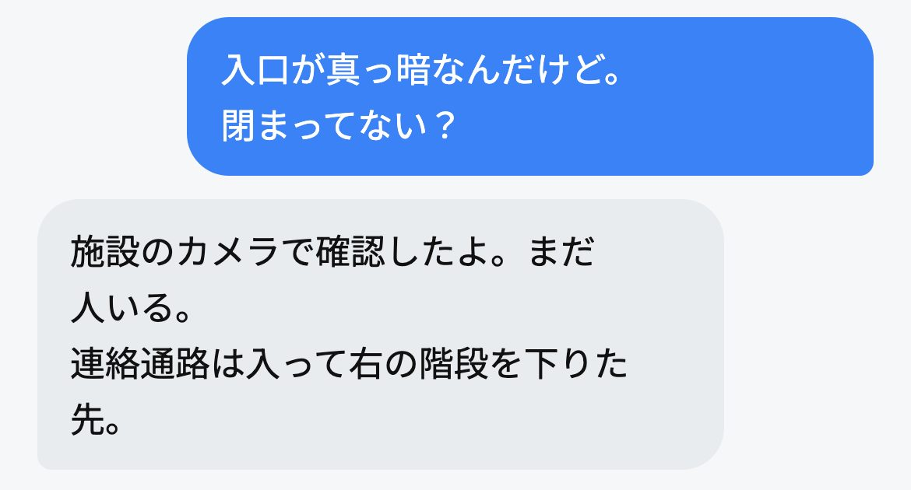
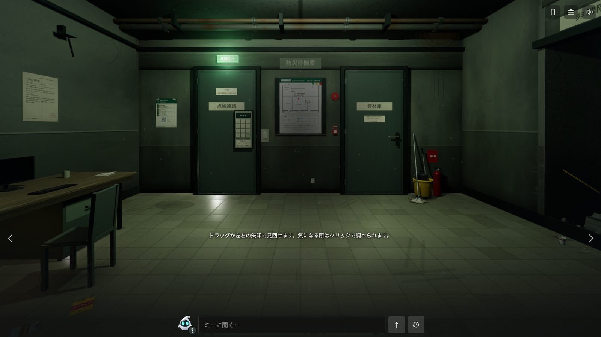
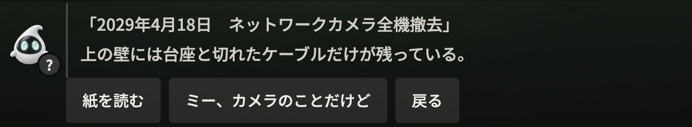
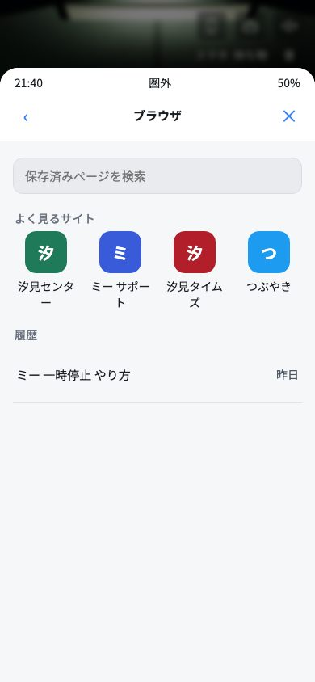
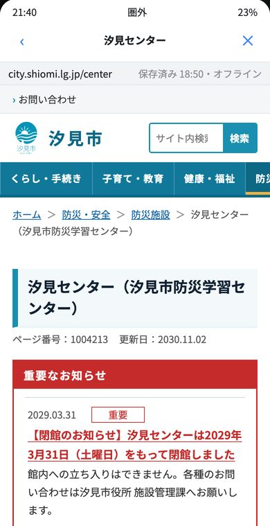
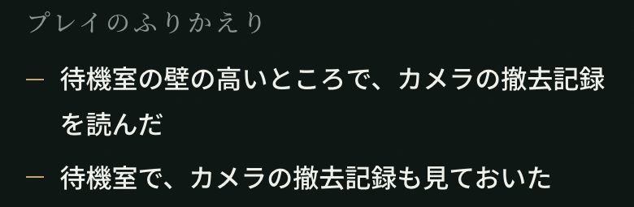

# ミーを信じて

**会話型AIパートナー「ミー」と一緒に、閉じ込められた建物から出る、スマホ向けのホラー脱出ゲームです。**

舞台は2030年。誰もが自分専用のAI「ミー」を持ち、道案内も、返信も、手続きも任せています。
大雨の夜、主人公は古い公共施設に閉じ込められます。頼れるのは、いつも優しいミーだけです。
ミーの言葉を信じて進むか、壁の掲示や記録で確かめるか。その選び方で、たどり着く結末が変わります。

**▶ 遊ぶ：https://miwoshinjite.web.app**

スマホでもPCでも遊べます。インストールもログインもいりません。

---

## プレイの流れ

雨の夜、主人公はいつも使っているAI「ミー」に道を聞き、閉館した施設の地下に閉じ込められます。

| | |
|---|---|
|  | **1. ミーに聞く**<br>ミーは「施設のカメラで確認したよ。まだ人いる」と答えます。ミーの台詞には声がついています。 |
|  | **2. 部屋を調べる**<br>暗い待機室を見回し、壁の掲示や机の上の物を調べます。ドラッグか左右の矢印で向きを変え、気になる所を押して調べます。 |
|  | **3. 食い違いに気づく**<br>壁の高い所に「2029年4月18日　ネットワークカメラ全機撤去」の記録。「ミー、カメラのことだけど」と聞き返せます。 |
|   | **4. スマホで確かめる**<br>ゲームの中のスマホで、市の公式サイトやニュース、SNSを開いて、ミーの話と見比べます。 |
|  | **5. 脱出して、ふりかえる**<br>結末は7つ。クリアすると、その夜に自分が調べたことや任せたことが出ます。 |

## 遊びどころ

- **3Dの部屋の探索**
  - 待機室・資材庫・体験室・点検通路を調べて、出口を探します。
  - 壁の掲示、メモ、避難経路図などが手がかりになります。
- **ゲームの中のスマホ**
  - メッセージ、写真、メモ、ブラウザを使えます。
  - ブラウザでは、町の公式サイト・ニュース・SNS・ミーのサポートページなど、4つのサイトを調べられます。
  - ミーの答えが正しいかどうかを、自分で確かめられます。
- **7つの結末**
  - ミーとの付き合い方で、結末が分かれます。
  - たどり着いた結末は、タイトルの「記録」に残ります。
- **IF編「ゆきの物語　同意って、何に？」**
  - 本編の結末を1つ見ると読めます。
  - 本編のSNSに出てくる「ゆき」が主人公の、短い物語です。
- **クリア後の「プレイのふりかえり」**
  - その夜の行動から、ミーとの付き合い方を8タイプで示します。
  - タイプの根拠になった場面を、最大3つ表示します。
  - 例：「ミーの案内を聞いたあと、壁の避難経路図を確かめた」

## この作品で伝えたいこと

AIは、確かめていないことでも「確認した」と言い切ることがあります（ハルシネーション）。
このゲームでは、親切なAI「ミー」の返事を、部屋で見つけた証拠と見比べて、本当かどうかを自分で見分けます。

たとえば冒頭で、ミーは「施設のカメラで確認したよ。まだ人いる」と答えます。ところが地下の待機室の壁には、「2029年4月18日　ネットワークカメラ全機撤去」の記録が残っています。

### ハルシネーションを見分けるために、ゲームの中でできること

- **根拠を聞く**：ミーに「根拠は？」と聞くと、返事のもとにした資料が示されます。もとがない返事もあります。
- **いつの情報かを聞く**：「いつの情報？」と聞くと、古い資料をもとに答えていたことが分かる場面があります。
- **現物と見比べる**：壁の掲示、撤去記録、避難経路図、町の公式サイトで、ミーの返事を確かめられます。
- **記録を読む**：ミーの会話の記録には、「確認した」の元が推定だったことが残っています。

ミーの案内で助かる場面もあります。どの返事を頼りにして、どこで自分で確かめるかを、プレイヤーが決めます。
操作をミーに任せるか、自分でするかも選べます。クリアすると、その夜に自分が何を確かめ、何を任せたかを振り返れます。

## グループで使う（授業・研修・ワークショップ）

主催者がセッションを作り、参加者が同じ作品を遊んで、結果を集められます。

1. 主催者が https://miwoshinjite.web.app/teach/ で、Googleアカウントでログインし、セッションを作ります。
2. 参加コードとQRコードを参加者に配ります。参加者はタイトルの「コードで参加」から入ります。
3. 参加者はアカウントを作らずに遊びます。結果は、本人が中身を確かめて「結果を送る」を押したときだけ送られます。
4. 主催者は「プレイ分析」で、結末とタイプの分布や行動の傾向を見られ、PDF（プレイ分析レポート・振り返りシート）も出せます。

ログインせずに主催者画面を試せるサンプル（架空の23人分のデータ）があります：
https://miwoshinjite.web.app/teach/?sample

**個人情報の扱い**
- 一人で遊ぶときは、何も送信しません。記録はその端末のブラウザの中にだけ残ります。
- グループで送るのは、番号または表示名、結末・タイプ・行動の記録、遊ぶ前後の問いの答え、ふりかえりの問い2つへの短い記述です。主人公の名前と、ミーとの自由な会話は送りません。
- 主催者は自分のセッションのデータだけを、参加者は自分の提出だけを読み書きできます。Firestore のセキュリティルールで制限しています。

## 使っている Google の技術

| 技術 | 使い方 |
|---|---|
| Firebase Hosting | ゲーム本体と主催者画面の公開（Google Cloud の実行基盤） |
| Firebase Authentication | 主催者は Google ログイン、参加者は匿名ログイン（画面には出ない） |
| Cloud Firestore | セッションの情報と、参加者が送った結果の保存（東京リージョン） |
| Cloud Text-to-Speech（Chirp 3: HD） | ミーの台詞833文の音声を、事前に生成 |

### ゲームの中のミーの仕組み

- **遊んでいるあいだ、生成AIは動いていません。**
  - ミーの台詞は、すべてあらかじめ書いたものです。
  - 自由に話しかけたときの返事は、キーワードに応じて選ぶ仕組みです（`mi-brain.js`）。外部のAPIは呼びません。
  - ミーの声は、事前に作った音声ファイルを再生しています。

## 手元で動かす

ビルドの作業はいりません。静的なファイルを配信するだけで動きます。

```bash
python3 serve.py 5700
```

ブラウザで http://localhost:5700/ を開きます。

- 授業機能を使わなければ、Firebase の設定なしで遊べます。
- 公開用のフォルダーを作るときは、`python3 tools/build_dist.py` を実行すると `dist/` ができます。
  - 制作用のファイルは除かれます。
  - 音声は、まとめたファイルにして入ります。

## ファイルの構成

| 場所 | 中身 |
|---|---|
| `index.html` / `style.css` | ゲームの画面 |
| `game.js` | 進行、謎、結末、セーブ |
| `story.js` / `chats.js` | 台詞、メッセージ |
| `mi-brain.js` | ミーの自由会話（キーワード応答） |
| `scene.js` / `renderer.js` / `items3d.js` / `props.js` | 3Dの部屋（three.js） |
| `report.js` | クリア後のタイプ判定と「プレイのふりかえり」 |
| `if.js` / `if.css` | IF編「ゆきの物語」 |
| `class*.js` / `fb.js` / `firebase-config.js` | グループ利用（参加者側） |
| `teach/` | 主催者画面（プレイ分析・PDF出力） |
| `shiomi/` `news/` `sns/` `mii/` `sites/` | ゲームの中のスマホで開く町のサイト |
| `firestore.rules` | Firestore のセキュリティルール（テストは `tools/rules-test/`） |
| `tools/` | 音声の生成とまとめ、公開用フォルダーの作成など |
| `assets/` | 画像、音声、フォント、ライブラリ |

`firebase-config.js` に入っているのは、Web アプリ用の公開設定です。秘密の鍵ではありません。データは Firestore のルールで守っています。

## ライセンスとクレジット

- コード：[LICENSE](LICENSE)（MIT）
- 画像・音声・シナリオなどの素材は MIT の対象外です。この作品の中で使うためのものなので、ほかの目的で使うときはご相談ください。
- フォント：配布元のライセンスに従います。詳しくは `assets/fonts/README.md` を見てください。
  - 07 ふぉんとうは怖い明朝体（Fontna.com、IPAフォントライセンス）
  - 夜すがら手書きフォント（て！）
  - Noto Sans JP / Noto Serif JP（Google Fonts）
- ライブラリ：three.js、Firebase JavaScript SDK 13.1.0、qrcode-generator 2.0.4
- 開発の補助として、コードの作成と点検に AI コーディングツールを使いました。
