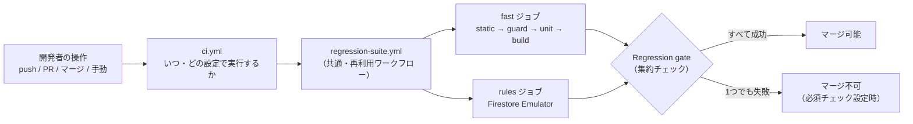
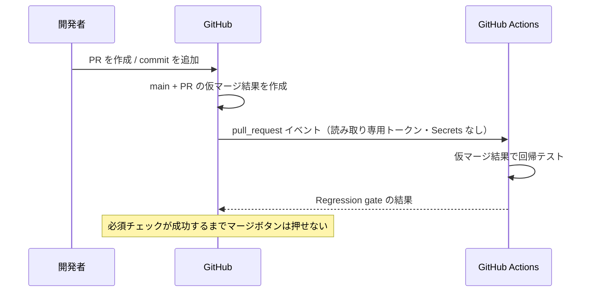
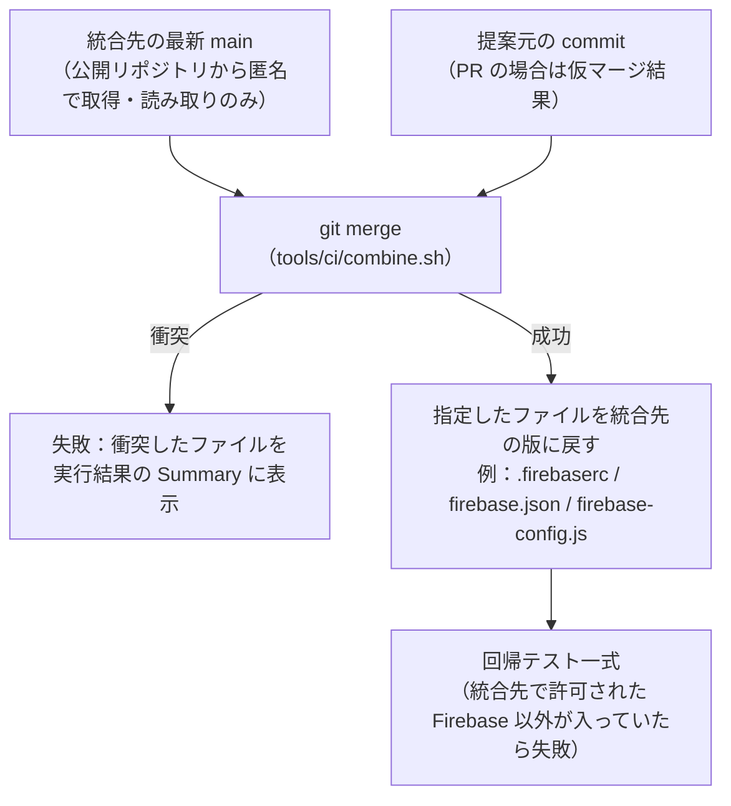
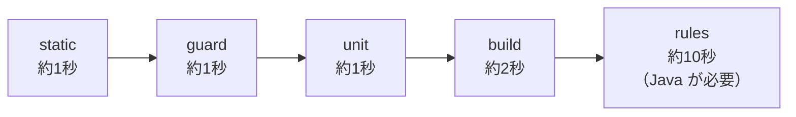

# 自動テスト（CI）の仕組み

> **3行で言うと**
> 1. PR・マージ・push のたびに、`tools/ci/run.sh` が構文・安全・集計・ルール・公開物を自動で検査します（デプロイも本番への接続もしません）。
> 2. 結果は `Regression gate` の1つにまとまり、これをマージ前の必須チェックにすると、失敗した変更は `main` に入りません。
> 3. ゲームの進行・画面・本番の Firebase 設定は、自動テストでは確かめていません（7章）。

GitHub Actions で、コードが変わるたびに同じ回帰テスト一式を自動で実行します。
開発者が毎回テストを手で全部実行しなくても、**壊れた変更・危険な変更が `main` に入る前に止まる**ことを目的にしています。

- テストの中身はすべて `tools/ci/` にあり、GitHub Actions と手元で**同じコマンド**（`tools/ci/run.sh`）を実行します。
- 「何を実行するか」（`tools/ci/`・`regression-suite.yml`）と「いつ実行するか」（`ci.yml`）を分けています。
  フォークなど別のリポジトリでも同じファイルをそのまま使え、違いは `ci.yml` に書く設定（実行タイミング、許可する Firebase プロジェクト）だけです。
- テストはデプロイをせず、秘密情報（Secrets）も使いません。Firebase の本番環境には一切接続しません。

> 数字（テスト件数・所要時間）は 2026-11-09 時点の実測です。

---

## 1. 全体像



| ファイル | 役割 |
|---|---|
| `.github/workflows/ci.yml` | **いつ**実行するか（トリガー）と、そのリポジトリの設定（許可・禁止する Firebase プロジェクト）。最後に `Regression gate` で結果をまとめる |
| `.github/workflows/regression-suite.yml` | **何を**実行するか。再利用ワークフロー（`workflow_call`） |
| `tools/ci/run.sh` | テストの入口。ステージを順に実行する（CI・手元で共通） |
| `tools/ci/check-static.mjs` | 構文・JSON・ファイル参照の検査 |
| `tools/ci/check-guard.mjs` | 秘密情報・危険なワークフロー・Firebase 接続先の検査 |
| `tools/ci/check-dist.mjs` | 公開用フォルダー `dist/` の検査 |
| `tools/ci/tests/*.test.mjs` | 単体テスト（集計・送信データとルールの一致） |
| `tools/ci/lib.mjs` | 上の検査が共有する関数と、秘密情報の検出パターン |
| `tools/ci/combine.sh` | 「別のリポジトリの `main` ＋ 変更」の統合ツリーを作る（3章の統合検証用。このリポジトリの `ci.yml` では使わない） |
| `tools/rules-test/test.mjs` | 既存の Firestore ルールテスト（Emulator） |
| `tools/rules-test/contract.mjs` | 実際のクライアントが作る送信データが、ルールで受け付けられるかのテスト（Emulator） |

---

## 2. テストを実行するタイミング

| 操作 | 実行内容 | テストされるコード |
|---|---|---|
| PR を `main` に作成・更新・再オープン | 回帰テスト一式 | **PR を `main` にマージした結果**（仮統合） |
| `main` へのマージ（push） | 回帰テスト一式 | マージ後の `main` |
| `main` 以外のブランチへの push | 回帰テスト一式 | その commit（PR を作る前の確認） |
| 手動（Actions → CI → Run workflow） | 回帰テスト一式 | 選んだブランチ |

### PR の「仮統合」とは

`pull_request` イベントでは、GitHub が PR のブランチを `main` に**仮にマージした結果**（`refs/pull/<番号>/merge`）を作り、
それをテストします。ブランチ単体では通っても、`main` の最新の変更と組み合わせると壊れる、という場合を検出できます。



---

## 3. 別のリポジトリで作った変更の統合検証（任意機能）

フォークなど別のリポジトリで開発した変更を、このリポジトリに PR として出す**前に**、
「このリポジトリの最新 `main` と組み合わせても動くか」を、提案元のリポジトリ側で確かめる仕組みです。
`regression-suite.yml` の入力 `integration-repo`・`integration-ref`・`integration-keep-upstream` で有効になります
（このリポジトリの `ci.yml` 自体は使いません）。



- 提案元の環境用の設定（Firebase の接続先など）は提案しないため、統合ツリーでは統合先の設定ファイルに戻してからテストします。
  これにより「この変更を PR したら、統合先のリポジトリはこうなる」というコードそのものを検証します。
- 統合先のリポジトリには何も書き込みません（`git fetch` のみ）。
- 統合先の `main` は日々変わるため、この結果は**テスト時点の `main` に対して**の保証です。
  実際に PR を出すと、統合先の CI があらためて仮統合テストを行います。

---

## 4. 各ステージで確かめること

`tools/ci/run.sh` は、時間のかからない順に実行し、失敗した時点で止まります。



| ステージ | 何を確かめるか | 何を防ぐか |
|---|---|---|
| `static` | すべての自作 JS が構文として正しい／JSON が読める／`import`・`src`・`href`・CSS `url()` の参照先ファイルが存在する | ファイル名の変更・削除や書き間違いで、ブラウザで開いたときに初めて壊れる事故 |
| `guard` | 秘密鍵・サービスアカウント鍵・トークン等がコミットされていない／ワークフローがデプロイ・書き込み権限・Secrets・`pull_request_target` を使っていない／Emulator が `demo-` プロジェクトで起動される／Firebase の接続先・URL が `ci.yml` で許可したプロジェクトだけ | 秘密情報の漏えい、CI からの誤デプロイ、別の環境（検証用プロジェクトなど）の Firebase 設定の混入 |
| `unit` | 主催者画面の集計（`teach/stats.js`）がサンプル授業で矛盾なく数えられる／送信データの項目・文字数上限・結末・タイプ・行動の値が `firestore.rules` と一致する／Python ツールが構文として正しい／`tools/test_*.py` があれば実行 | 集計の数え間違い、クライアントとルールの食い違いによる「本番で提出が拒否される」事故 |
| `build` | `tools/build_dist.py` が作る `dist/` に必要なページがあり、中の参照がすべて `dist/` 内で解決し、ツール・文書・設定・鍵が含まれない | 公開物の欠け、公開してはいけないファイルの公開 |
| `rules` | 既存のルールテスト（63件）＋ 送信データの契約テスト（43件）を Firestore Emulator で実行 | 他人のデータの読み書き、不正な形式の提出の許可、正しい提出の拒否 |

`fast` ＝ static・guard・unit・build（Java 不要、約5秒）。`all` ＝ fast ＋ rules。

### テストの一覧（何を、どのファイルで確かめているか）

| 保証すること | ファイル | テスト（件数） |
|---|---|---|
| 構文・JSON・ファイル参照 | `tools/ci/check-static.mjs` | 自作の JS 全件・JSON 全件・参照 約190件（実行時に件数を表示） |
| 秘密情報・ワークフローの安全・Emulator・Firebase の接続先 | `tools/ci/check-guard.mjs` | 冒頭のコメントに検査項目の一覧（1〜4） |
| 主催者画面の集計 | `tools/ci/tests/stats.test.mjs` | 8件：合計の整合、結末の件数、絞り込み、古い版の扱い、仮名、補助関数、0件のとき |
| 送信データとルールの一致（静的） | `tools/ci/tests/submission-contract.test.mjs` | 5件：項目、文字数の上限、結末・タイプ・選択肢、行動の値、自由記述の切り詰め |
| 公開物 `dist/` | `tools/ci/check-dist.mjs` | 必須ページ、公開してはいけないファイル、`dist/` 内の参照 |
| Firestore ルールの許可・拒否 | `tools/rules-test/test.mjs` | 63件：授業の作成（6）・参加コードと公開情報（10）・参加（7）・提出（17）・読む（11）・受付の終了と削除（12） |
| 実際の送信データがルールに通る | `tools/rules-test/contract.mjs` | 43件：標準の提出（3）・全結末（7）・全タイプ（8）・全行動の値（24）・対照（1） |

テスト名は日本語で「何を保証するか」を書いています。実行結果の一覧だけで、何を確かめたかが分かります。

### Firestore Emulator を使う理由

Firestore のセキュリティルールは、実際に読み書きを試さないと正しさを確かめられません。
本番の Firebase で試すと、データを汚したり、設定を誤って変えたりする危険があります。

- Emulator は手元・CI のマシンの中だけで動く Firestore の模擬環境です。
- プロジェクトIDを `demo-mi-rules` にしています。`demo-` で始まるIDは Firebase CLI が「実在しないデモ用」と扱い、
  **本物のプロジェクトへの接続を拒否**します。ログインやトークンも不要です。
- `guard` は、`demo-` 以外のプロジェクトで Emulator を起動する記述があると失敗します。
  対象はコマンドが書かれる場所（ワークフロー、`.sh`、`package.json` の scripts）です。JS の説明文やエラーメッセージに出てくるコマンド名は対象外です。

### 補足：`node --check` の落とし穴

Node.js 22 以降では、`node --check file.js` は **ES Module に構文エラーがあっても成功（終了コード 0）を返す**ことがあります
（モジュール形式の自動判定のため）。`check-static.mjs` は、ソースを標準入力から `--input-type` を明示して渡すことで、
この見逃しを防いでいます。

---

## 5. Regression gate（必須チェック）

各 `ci.yml` の最後のジョブ `Regression gate` は、それまでのジョブ結果を1つにまとめます。

- 回帰テストが「成功」でなければ失敗します（失敗・キャンセル・未実行のいずれも不可）。
- 3章の統合検証を併用する構成では、その結果が「失敗」「キャンセル」の場合も失敗にします（実行対象外の「スキップ」は可）。

**必須チェックにはこの1つだけを指定します。** 個々のジョブ名を指定すると、ジョブの追加・名前の変更のたびに
ブランチ保護の設定を直す必要がありますが、`Regression gate` の名前は変わりません。

---

## 6. テストが失敗したときの対応

まず Actions の実行結果を開き、失敗したジョブ → 赤くなったステップのログを見ます。手元では同じステージだけを実行できます。

```sh
tools/ci/run.sh static        # 失敗したステージ名を指定
```

| 失敗したステージ | よくある原因 | 対応 |
|---|---|---|
| `static` の `syntax:` | JS の書き間違い | 表示された行を直す |
| `static` の `missing: A -> B` | ファイル名の変更・削除で参照が切れた | 参照先を直すか、ファイルを戻す |
| `guard` の `secret ...` | 鍵・トークンをコミットした | **ファイルを消すだけでは不十分**。その鍵を発行元で無効化し、再発行する。履歴の書き換えは管理者と相談 |
| `guard` の workflow 関連 | ワークフローに書き込み権限・Secrets・デプロイを追加した | 回帰テストには不要。どうしても必要なら別ワークフローとして設計レビューを受ける |
| `guard` の Firebase 接続先 | 許可リストにないプロジェクト・サイトIDが設定やURLに入った（別の環境の設定が混ざった） | `.firebaserc`・`firebase.json`・`firebase-config.js` などを、このリポジトリ用の値に戻す。正式に追加する場合は `ci.yml` の `allow-firebase-ids` も更新する |
| `unit` の契約テスト | `class-data.js` と `firestore.rules` の片方だけを変えた | 両方をそろえて変更する（項目・上限・値の一覧） |
| `unit` の集計テスト | `teach/stats.js` の数え方が変わった | 意図した変更か確認。意図どおりならテストの期待も直す |
| `build` | `build_dist.py` の対象フォルダーの漏れ、公開してはいけないファイル | `build_dist.py` の対象一覧を直す |
| `rules` | ルールの変更で既存の許可・拒否が変わった | 意図した変更か確認。意図どおりならテストを追加・修正する |
| 統合検証（3章）の「衝突」 | 統合先の `main` と同じ箇所を変更した | 統合先の `main` を作業ブランチに取り込み、衝突を解消してから push |
| 統合検証（3章）だけ失敗 | 統合先の `main` 側の変更と組み合わせると壊れる | どちらの変更が原因か確認し、提案元で直してから提案する |

**テストを無効化・スキップして通すことはしないでください。** テストの期待そのものが古い場合は、理由を書いて修正します。

---

## 7. テストで保証できない範囲

自動テストが成功しても、次のことは**確かめていません**。必要に応じて人が確認してください。

| 範囲 | 理由・補足 |
|---|---|
| ゲームの進行・謎・分岐・7つの結末に至る流れ | `game.js` の進行はテストしていません（ブラウザ操作の E2E テストは未導入） |
| 画面の見た目・レイアウト・3D 表示・音声・操作感 | ブラウザを起動するテストがありません |
| 対応ブラウザ・端末ごとの動作、表示速度 | 同上 |
| 実行時に組み立てるファイル名（例 `assets/img/${name}.jpg`） | 文字列が実行時に決まるため、`static` では検査できません |
| 本番の Firebase の設定（実際に適用されているルール、認証方式、API キーの制限、承認済みドメイン） | テストは Emulator だけで行い、本番には接続しません。コンソールでの確認が必要です |
| 公開中のサイトの状態 | デプロイは CI の対象外です |
| テストケースにない Firestore ルールの抜け道 | ルールテストは書かれたケースだけを確かめます |
| 想定外の形式の秘密情報 | `guard` は代表的な形式（秘密鍵・サービスアカウント鍵・トークン等）を検出します。すべての形式は網羅できません |
| チームの `main` がテスト後に変わった場合 | 統合検証はテスト時点の `main` に対するものです |

---

## 8. 安全のための設計

| 対策 | 内容 |
|---|---|
| 最小権限 | すべてのワークフローが `permissions: contents: read`。`guard` が `write` 権限の追加を検出して失敗させる |
| 信頼できないコードを特権で動かさない | 受け取ったコードのテストは `pull_request` だけ。`pull_request_target`・`workflow_run` は `guard` が拒否。フォークからの PR は読み取り専用トークン・Secrets なしで動く |
| Secrets を使わない | Firebase の鍵やトークンを GitHub に登録しない。`secrets.*`・`secrets: inherit` は `guard` が拒否 |
| デプロイしない | `firebase deploy` やデプロイ用 Action を `guard` が拒否。デプロイは人が事前確認をしてから手動で行う |
| 認証情報を残さない | `actions/checkout` は `persist-credentials: false` |
| 外部コードの固定 | GitHub 製の Action はコミット SHA で固定。npm の依存は lock ファイルとバージョン指定で固定 |
| 接続先の取り違え防止 | `ci.yml` の `allow-firebase-ids` に書いた Firebase プロジェクト・Hosting サイト以外が、設定ファイルや公開コードの Firebase URL に入ると失敗（許可リスト方式なので、未知の環境もすべて止まる） |

将来、自動デプロイを導入する場合は、このワークフローとは別にし、GitHub の Environment（承認者つき）と
鍵を保存しない認証（Workload Identity Federation）を使う設計を、別途レビューしてください。

---

## 9. 手元での実行

```sh
tools/ci/run.sh            # fast（Node.js と Python 3 だけで実行できる）
tools/ci/run.sh all        # ＋ Firestore Emulator（Java 11 以上。firebase コマンドが無ければ npx で取得）
tools/ci/run.sh unit rules # ステージを選んで実行
```

CI と同じ Node.js 24・Python 3.12・Java 21 を推奨します（`regression-suite.yml` の `env`）。

テストを1ファイル・1件だけ実行する：

```sh
node --test tools/ci/tests/stats.test.mjs                               # 1ファイル
node --test --test-name-pattern="結末" tools/ci/tests/stats.test.mjs    # 名前に「結末」を含むテストだけ
firebase emulators:exec --only firestore --project demo-mi-rules --config firebase.json \
  "node tools/rules-test/contract.mjs"                                  # ルールのテストを1ファイルだけ（Emulator）
```

---

## 10. マージ前のテストを必須にする設定（管理者向け）

以下の設定には、リポジトリの**管理者（Admin）権限**が必要です。
`Regression gate` は一度実行されると選択肢に出るので、先にワークフローを1回動かしてから設定します。

### 10-1. `main` のルールセット

*Settings → Rules → Rulesets → New ruleset → New branch ruleset*

- **Ruleset name**：`protect-main`　**Enforcement status**：Active
- **Bypass list**：空のままにする（管理者も失敗した PR をマージできないようにする）
- **Target branches**：Add target → Include default branch
- 有効にする規則：
  - **Restrict deletions**（ブランチ削除の禁止）
  - **Block force pushes**（履歴の強制上書きの禁止）
  - **Require a pull request before merging**
    - チーム：Required approvals を 1 以上、Dismiss stale pull request approvals when new commits are pushed、Require conversation resolution before merging
    - 1人で開発するリポジトリ：Required approvals は 0
  - **Require status checks to pass** → Add checks で `Regression gate`（GitHub Actions）を追加し、
    **Require branches to be up to date before merging** を有効にする（テストした仮統合結果と、実際にマージされる内容を一致させるため）
- （チーム・任意）**Require review from Code Owners** と `.github/CODEOWNERS`
  （例：`/.github/ @<担当者>`、`/tools/ci/ @<担当者>`）で、CI 自体の変更に担当者のレビューを必須にする

従来のブランチ保護（*Settings → Branches → Add branch protection rule*）でも、同じ項目で設定できます。

**プランによる制限**：ルールセット・ブランチ保護は、公開リポジトリではすべてのプランで使えますが、
**非公開リポジトリでは GitHub Pro / Team / Enterprise が必要**です。Free プランの非公開リポジトリでは、
CI の実行と結果の表示はされますが、マージを止めることはできません。

### 10-2. Actions の設定

*Settings → Actions → General*

- **Actions permissions**：Allow *(所有者)*, and select non-*(所有者)*, actions and reusable workflows →
  Allow actions created by GitHub にチェック（このテストが使う Action はすべて GitHub 製）。
  Require actions to be pinned to a full-length commit SHA があれば有効にする
- **Workflow permissions**：Read repository contents and packages permissions。
  Allow GitHub Actions to create and approve pull requests は**チェックしない**
- （チーム・公開リポジトリ）**Fork pull request workflows from outside collaborators**：
  Require approval for all external contributors（外部からの PR は、管理者が中身を見てから CI を動かす）
- *Settings → Secrets and variables* に Firebase / Google Cloud の認証情報を**登録しない**

### 10-3. 任意

- *Settings → General → Pull Requests → Allow auto-merge*：必須チェックとレビューが通ると自動でマージ
- *Settings → Code security*：Secret scanning と Push protection（公開リポジトリは無料）を有効にし、`guard` の二重の守りにする

---

## 11. 別のリポジトリと共通ファイルを使う場合

`tools/ci/`、`regression-suite.yml`、`tools/rules-test/contract.mjs`、`docs/CI.md`、`docs/README.md` は、
フォークなど別のリポジトリでもそのまま使えるように、リポジトリ固有の値を含めていません（固有の設定は `ci.yml` だけ）。
共通ファイルを変更するときは、使っているすべてのリポジトリで同じ内容にそろえてください。

---

## 12. テストを追加・変更するとき

| 追加したいもの | 置き場所と手順 |
|---|---|
| JS の単体テスト | `tools/ci/tests/` に `〜.test.mjs` を置くだけで、`unit` ステージが自動で実行します（`node:test`）。テスト名は「何を保証するか」を日本語で書く |
| Firestore ルールのテスト | `tools/rules-test/` にファイルを追加し、`tools/rules-test/package.json` の `test` スクリプトに足す。プロジェクトIDは必ず `demo-` で始める |
| Python のツールのテスト | `tools/test_〜.py`（`unittest`）を置くと、`unit` ステージが自動で実行します |
| 新しい検査（ステージ） | `tools/ci/run.sh` に `stage_〜` 関数を足し、`fast` か `all` の並びに加える。時間がかかるものは `regression-suite.yml` に別ジョブとして足し、`ci.yml` の `Regression gate` の `needs` にも加える |
| 新しい Firebase プロジェクト・Hosting サイト | `ci.yml` の `allow-firebase-ids` に追加する（追加しないと `guard` が失敗する） |

- 送信データの項目を増やすときは、`class-data.js` と `firestore.rules` を**同じ PR で**変更します（契約テストが片方だけの変更を検出します）。
- テストの期待値を変えるときは、仕様の変更なのか不具合なのかを PR に書きます。テストを無効化・スキップして通すことはしません。
