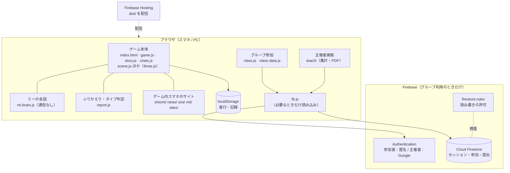
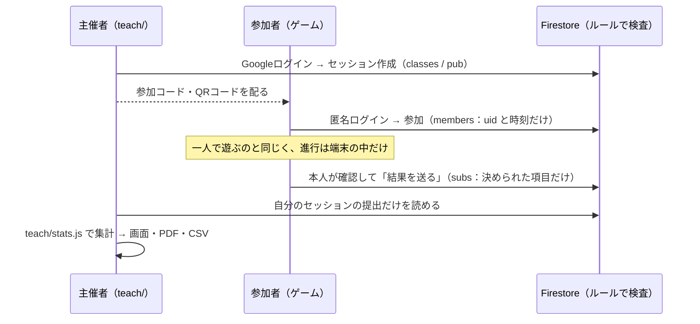
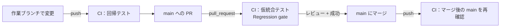

# コードを読む人のためのガイド

審査員・共同開発者が、短時間で設計と技術的な工夫をつかむための案内です。
作品の内容・遊び方・使っている Google の技術・個人情報の扱い・ファイル一覧は、リポジトリ直下の [README](../README.md) にあります。
ここではそれを繰り返さず、**コードの構成と設計の判断**を説明します。

## 読む順番（約3分）

| 順 | 読むもの | 分かること |
|---|---|---|
| 1 | [README](../README.md) の冒頭と「プレイの流れ」 | 何を作ったか（ハルシネーションを見分けるホラー脱出ゲーム） |
| 2 | この文書の [1章](#1-技術的な工夫要点) と [2章](#2-システム構成) | 技術的な工夫の要点と、システムの構成図 |
| 3 | [docs/CI.md](CI.md) の冒頭「3行で言うと」と1章 | 自動テストの全体像と、何を保証しているか |
| 4 | この文書の [7章](#7-実装済みのもの確かめていないこと将来構想) | 実装済みのもの・テストで確かめていないこと・将来構想の区別 |

コードを読むときの入口：

| 知りたいこと | 最初に開くファイル | 次に読むファイル |
|---|---|---|
| ゲームの進行 | `index.html`（`game.js` を読み込む） | `game.js` → `story.js`・`chats.js`・`mi-brain.js`・`report.js` |
| グループ利用（参加者） | `class.js` | `class-data.js`（送る項目）→ `fb.js`（Firebase）→ `firestore.rules` |
| 主催者画面 | `teach/index.html` → `teach/teach.js` | `teach/stats.js`（集計）・`teach/pdf.js`（PDF） |
| 自動テスト | `tools/ci/run.sh`（入口。ステージの一覧） | `tools/ci/check-*.mjs` → `tools/ci/tests/` → `tools/rules-test/` |

---

## 1. 技術的な工夫（要点）

| 工夫 | どこで確認できるか |
|---|---|
| **ビルド工程のない静的サイト**。ES Modules をそのまま配信し、three.js も `importmap` で読み込む | `index.html`、`assets/three.module.js` |
| **一人で遊ぶときは通信しない**。進行はすべて端末のブラウザ（localStorage）に保存。Firebase はグループ利用の操作をしたときだけ動的に読み込む | `game.js`（セーブ）、`class.js`・`teach/data.js` の `import('./fb.js')` |
| **ミーの会話に生成AIを使わない**。キーワードと状況から返事を選ぶため、教材として結果が再現できる | `mi-brain.js` |
| **タイプ判定は乱数を使わない純粋関数**。同じ行動記録なら必ず同じ結果 | `report.js` の `judge()` |
| **送る項目をクライアントとルールの両方で限定**。送信データは1か所（`buildSubmission`）で組み立て、ルールは項目の完全一致・文字数・値の一覧で検査 | `class-data.js`、`firestore.rules` |
| **主催者画面の集計を1か所に集約**。画面・PDF・CSV が同じ数値を使う | `teach/stats.js` |
| **手元では本番に接続しない**。localhost で開くと自動で Firebase Emulator に接続する | `fb.js`、`firebase-config.js` の `EMULATOR` |
| **公開物を限定してビルド**。メモ・ツール・設定を公開フォルダーに入れない。音声833文は小さなまとめファイルにして配信 | `tools/build_dist.py`、`tools/voice_pack.py` |
| **自動回帰テスト**。push・PR ごとに、構文・参照・秘密情報・集計・ルールとの契約・公開物・Firestore ルールを検査 | [docs/CI.md](CI.md)、`tools/ci/` |

---

## 2. システム構成



### グループ利用のデータの流れ



ルールでは、主催者は自分のセッションだけ、参加者は自分の提出だけを読み書きでき、決められた項目以外を含む提出は拒否されます。

---

## 3. 使用技術と、コードから読み取れる採用理由

| 技術 | 採用理由（設計上の効果） |
|---|---|
| Vanilla JavaScript（ES Modules）、ビルドなし | 依存とビルド手順が少なく、配信するファイルがそのままソースになる。読む人がビルド結果を追わなくてよい |
| three.js | ブラウザだけで3Dの部屋を表示できる。`assets/` に同梱し、外部の配信サービスに依存しない |
| Firebase Authentication（匿名 / Google） | 参加者はアカウントを作らずに参加でき、主催者だけが Google で本人確認される |
| Cloud Firestore（Lite SDK）＋ セキュリティルール | サーバーのプログラムを持たずに、ルールだけで「誰が何を読み書きできるか」を制御できる。Lite SDK はリアルタイム同期を含まず軽い |
| Firebase Hosting | 静的ファイルの配信だけで動く構成に合う |
| pdf-lib・qrcode-generator（同梱） | PDF と QR コードを端末の中で作るため、データを外部に送らない |
| Node.js の `node:test`・Python 標準ライブラリ（CI） | テスト用の追加依存をほぼ持たず、どの環境でも同じコマンドで動く（Emulator のテストだけは npm の依存を使う） |
| GitHub Actions ＋ Firestore Emulator | push・PR のたびに自動で検査。本番の Firebase に接続せずにルールを試せる |

---

## 4. 開発に関わるディレクトリ

ゲームのファイル一覧は [README の「ファイルの構成」](../README.md) を見てください。ここでは開発・テスト用のものだけを挙げます。

| 場所 | 中身 |
|---|---|
| `.github/workflows/` | GitHub Actions。`ci.yml`（いつ実行するか）と `regression-suite.yml`（何を実行するか） |
| `tools/ci/` | 回帰テストの本体。入口は `run.sh`（[docs/CI.md](CI.md)） |
| `tools/rules-test/` | Firestore ルールのテスト（Emulator 上で実行） |
| `tools/build_dist.py` | 公開用フォルダー `dist/` を作る |
| `serve.py` | 手元で確認するための簡易サーバー（キャッシュ無効） |
| `docs/` | この文書と CI の説明 |

---

## 5. 手元での実行とテスト

必要なもの：Python 3（ゲームの表示）、Node.js 22 以上（テスト）、Java 11 以上（Firestore ルールのテストだけ）。

```sh
python3 serve.py              # http://localhost:5700/ でゲームを開く
tools/ci/run.sh               # 回帰テスト（fast：約5秒、Java 不要）
tools/ci/run.sh all           # ＋ Firestore ルールのテスト（Emulator）
python3 tools/build_dist.py   # 公開用フォルダー dist/ を作る（デプロイはしない）
```

- 一人で遊ぶ範囲は、`serve.py` だけで確認できます（Firebase を使いません）。
- localhost で開いたページがグループ利用の機能を使うと、`fb.js` は本番ではなく Emulator（`firebase-config.js` の `EMULATOR`）に接続しようとします。
  URL に `?fb=live` を付けると、そのタブでは本番の Firebase に接続するので、ルールの確認前には使わないでください。

---

## 6. 開発・テスト・統合の流れ



フォークなど別のリポジトリで作った変更は、PR を出す前に提案元で「このリポジトリの最新 `main` ＋ 変更」の回帰テストを実行でき
（[docs/CI.md の 3章](CI.md#3-別のリポジトリで作った変更の統合検証任意機能)）、PR を出すとこのリポジトリの CI があらためて仮統合テストを行います。

---

## 7. 実装済みのもの・確かめていないこと・将来構想

| 状態 | 内容 |
|---|---|
| 実装済み・自動テストあり | Firestore ルールの許可・拒否（63件）、送信データとルールの一致（43件＋静的検査）、主催者画面の集計、公開物の内容、秘密情報・誤デプロイの検出 |
| 実装済み・自動テストなし | ゲームの進行・謎・7つの結末・IF編、3D 表示、ゲーム内スマホ、音声、ふりかえり画面、主催者画面の表示と PDF 出力（人が操作して確認） |
| 手作業で確認が必要 | 本番 Firebase の設定（適用中のルール、認証方式、API キーの制限、承認済みドメイン）、公開サイトの状態 |
| 将来構想（未実装） | ブラウザ操作の自動テスト（E2E）、主催者を承認制にする仕組み、デプロイ前の自動確認、台詞・ニュースなどの内容をデータとして編集する仕組み |

「自動テストあり」は、[docs/CI.md の 7章](CI.md#7-テストで保証できない範囲) に書いた範囲での保証です。
